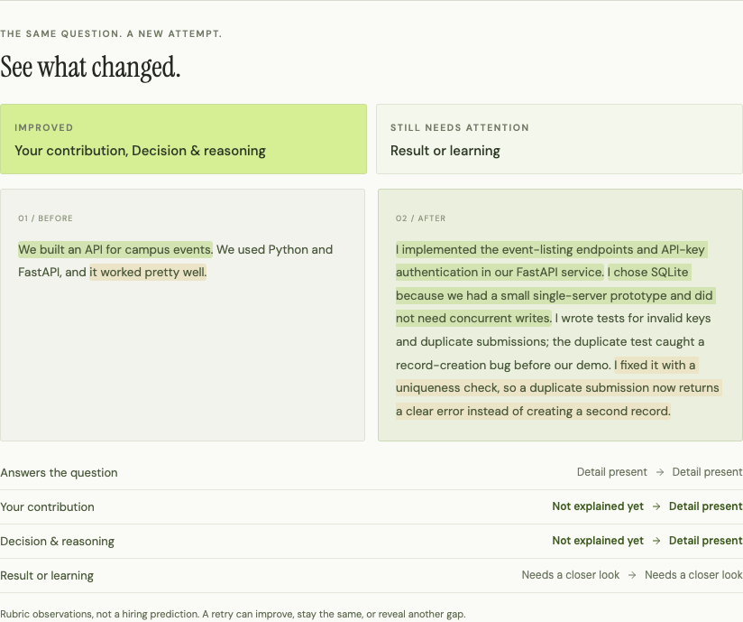
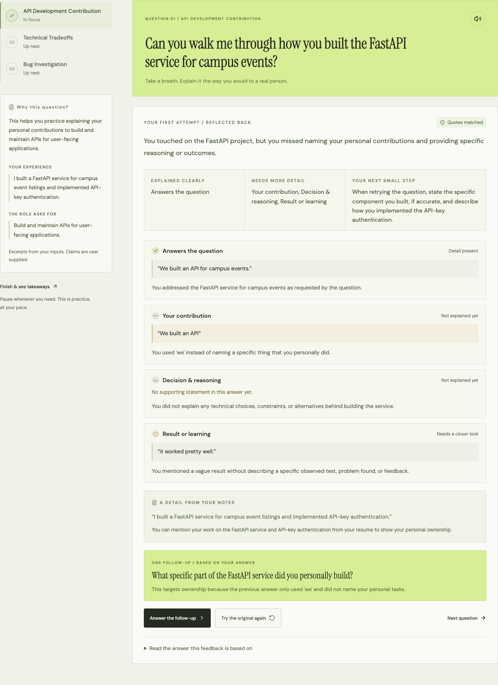

# InterviewMirror

**You have the experience. Practice explaining it.**

InterviewMirror is an interview-practice coach for students. It asks questions grounded in
your own resume and a real job description, shows exactly which words in your answer its
feedback is based on, asks one targeted follow-up, and lets you retry the question so you
can see what changed.

Built solo for **WhitHack 2026** (Ingeniux challenge: accessible, on-demand interview
practice with personalized questions and realistic feedback).

[](https://github.com/raimbekalish/interviewmirror/actions/workflows/ci.yml)



## The problem

Students often have real project experience but explain it poorly in interviews: “We built
an API, it worked well.” The interviewer still doesn’t know what *you* did, why you made a
decision, or what happened. Generic practice tools ask generic questions and return a score
or a wall of advice, with no way to tell what the feedback is based on.

## What it does

1. **Personalized questions.** Paste a resume and a job description. Gemini picks three
   questions, each tied to an exact resume line and an exact job requirement, which are
   shown next to the question.
2. **Feedback you can check.** Each answer is observed on four criteria: *answers the
   question*, *your contribution*, *decision & reasoning*, *result or learning*. Every
   rated observation quotes the exact words in your answer it is based on.
3. **One adaptive follow-up.** A single, narrower question aimed at the biggest gap, with
   the reason it was chosen.
4. **Retry and compare.** Answer the original question again (as many times as you like).
   The comparison shows both attempts side by side, which criteria improved, which still
   need attention, and any that got weaker.
5. **Takeaways.** A summary of all questions, copyable or downloadable as JSON.
6. **Voice input.** Record up to 60 s; Gemini transcribes it into an editable text box.
   Typing always works.
7. **Local practice mode.** Works with no API key using fixed questions and transparent
   keyword rules. It is clearly labeled **not AI** everywhere it appears.



## How the AI workflow works

```text
Resume + job description
  → /api/plan      3 questions, each with an exact resume excerpt and job excerpt
  → answer (typed or transcribed)
  → /api/assess    4 criteria, each with an exact quote from the answer,
                   one follow-up + reason, next step, optional resume hint
  → follow-up answer (assessed together with the first answer)
  → retry of the original question → /api/assess
  → comparison of first attempt vs latest retry, computed in the browser
```

Every Gemini call uses **JSON Schema structured output**, then the server validates it:

- **Pydantic** checks the shape, lengths, and that each criterion appears exactly once.
- **Quote checks:** every quoted excerpt must be a contiguous substring of the answer
  (or resume / job description). A quote that differs only in whitespace, curly quotes, or
  dashes is replaced by the original text first, so what you see is always verbatim.
  Anything else is rejected, never displayed.
- **No invented achievements:** prompts forbid adding facts, numbers, or results; next
  steps may only reference details already in the answer or resume and say “if accurate”.
  As a deterministic guard, an outcome quote containing a number that appears nowhere in
  the resume is capped at “Needs a closer look”.
- **Reliability:** each request tries `GEMINI_MODEL`, then `GEMINI_FALLBACK_MODEL` if the
  first is busy (429/5xx), slow (28 s), or fails the checks, then the primary once more if
  time remains within the browser’s 65 s limit. The response header
  `X-InterviewMirror-Model` and the server log name the model that actually answered.

The quote check proves a passage exists in your input. It does **not** prove a claim is
true, and Gemini’s judgment can be wrong. This is practice feedback, not a hiring
prediction, and there is deliberately no overall score.

## Tech stack

- **Frontend:** React 19, TypeScript, Vite, lucide-react icons
- **Backend:** FastAPI, Pydantic v2, HTTPX (async), python-dotenv
- **AI:** Google Gemini `generateContent` REST API with JSON Schema output and audio input
- **Tests:** Node’s built-in test runner + JSDOM + Testing Library; pytest with a mocked
  Gemini client; GitHub Actions CI (no credentials, no live API calls)

## Architecture

```text
Browser (React, state kept in memory for this tab)
   │  same-origin HTTP
FastAPI (serves the built UI and the API on 127.0.0.1:8000)
   ├─ GET  /api/health      key configured? which model? (never the key)
   ├─ POST /api/plan        resume + job → 3 grounded questions
   ├─ POST /api/assess      resume + job + question + answer → quote-checked rubric
   └─ POST /api/transcribe  audio (≤10 MB) → transcript
   │  API key sent server-side in an HTTP header
Google Gemini
```

The server is stateless: no database, no stored answers or audio. Code lives in
[`backend/main.py`](backend/main.py) and [`frontend/src/`](frontend/src/).

## Run it locally

Requires **Node.js 22+** and **Python 3.12+**.

```bash
git clone https://github.com/raimbekalish/interviewmirror.git
cd interviewmirror
cp .env.example .env
```

Put a key from [Google AI Studio](https://aistudio.google.com/apikey) in `.env`
(`GEMINI_API_KEY=...`), or export `GEMINI_API_KEY` in your shell; an exported variable
takes precedence. Never put the key in frontend code or a commit (`.env` is git-ignored).
Without a key, the app still runs in local practice mode.

```bash
./start.sh
```

Open **http://127.0.0.1:8000**. The script creates `.venv`, installs dependencies, builds the
UI, and serves everything with FastAPI. Stop with Ctrl+C; restart after editing `.env`.

Manual equivalent:

```bash
python3 -m venv .venv
.venv/bin/pip install -r backend/requirements.lock.txt
npm ci
npm run build
.venv/bin/python -m uvicorn backend.main:app --host 127.0.0.1 --port 8000
```

For frontend development, keep the API running and use `npm run dev` (Vite proxies `/api`
to port 8000). On Windows use `.venv\Scripts\python`.

**Environment variables** (see [`.env.example`](.env.example)):

| Variable | Default | Purpose |
| --- | --- | --- |
| `GEMINI_API_KEY` | — | Required for AI mode. Server-side only. |
| `GEMINI_MODEL` | `gemini-3.5-flash-lite` | Primary model |
| `GEMINI_FALLBACK_MODEL` | `gemini-flash-lite-latest` | Tried if the primary is busy, slow, or fails checks |
| `GEMINI_THINKING_LEVEL` | `low` | Gemini 3 thinking level; leave empty for models without it |

Check the live connection before a demo (prints timings and PASS/FAIL, never the key):

```bash
.venv/bin/python -m backend.preflight
```

## Local practice mode

Choose **Local practice** on the setup screen. Questions come from fixed templates;
feedback comes from simple English keyword rules in
[`frontend/src/local-engine.mjs`](frontend/src/local-engine.mjs). Nothing is sent anywhere.
It exercises the full coaching loop but does not understand meaning, so its relevance check
never goes above “Needs a closer look”. The header reads “Local practice · no AI”.

## Tests

```bash
npm run build                                # type-check + production build
npm test                                     # 15 UI and local-engine tests (JSDOM)
.venv/bin/python -m pytest backend/tests -q  # 33 API tests, Gemini mocked
```

Covered: quote grounding and anchoring, rejected fabricated quotes and resume hints,
duplicate criteria, model fallback order, busy/timeout/invalid-key handling, the timing
budget, the model header, transcription context, input limits, the full local coaching
loop, repeated retries compared against the first attempt, the comparison summary, the
leave warning, microphone-permission errors, and answers preserved after failures.

Browser checks with real Gemini and Chrome are recorded in
[docs/verification.md](docs/verification.md). Unit tests do not cover layout, real
microphones, or provider behavior.

## Known limitations

- **No persistence.** Sessions live in the browser tab; reloading clears them (the app
  warns before leaving once you have answered). Download the report to keep it.
- **Model variance.** The same answer can get slightly different ratings across runs
  (for example “Not explained yet” vs “Needs a closer look”). Quotes are always checked.
- **Gemini availability.** Google returned 503 “high demand” errors during testing; the
  fallback handles most of them, but if every attempt fails the app says so and keeps your
  answer. It never switches to local mode silently.
- **Voice.** Tested in Chrome with a simulated microphone. A physical microphone and
  Safari/Firefox recording codecs have not been verified. Transcripts can misspell technical
  terms, so they are always editable.
- **English only** for the local mode rules. **Local use only:** the server binds to
  loopback and has no authentication; it should not be exposed as a public AI proxy.

## Privacy and security

- The API key stays on the server and is sent to Google in a request header.
- AI mode sends the resume, job description, answers, and (only when recording) audio to
  Google; processing follows your key’s terms. Local mode sends nothing.
- The server never logs inputs, provider response bodies, or the key.
- Example data belongs to a fictional student, Alex Morgan.

## Project docs

- [docs/demo.md](docs/demo.md): two-minute script, click-by-click demo, backup plan,
  morning checklist, microphone checklist
- [docs/pitch.md](docs/pitch.md): spoken pitch, 30-second version, judges’ questions
- [docs/verification.md](docs/verification.md): what was verified, how, and what was not

## Acknowledgments

Built by Raimbek Alish, during WhitHack 2026, with AI-assisted
implementation. React, Vite, FastAPI, Pydantic, HTTPX, and Lucide are third-party
dependencies; fonts are DM Sans and Instrument Serif from Google Fonts.
